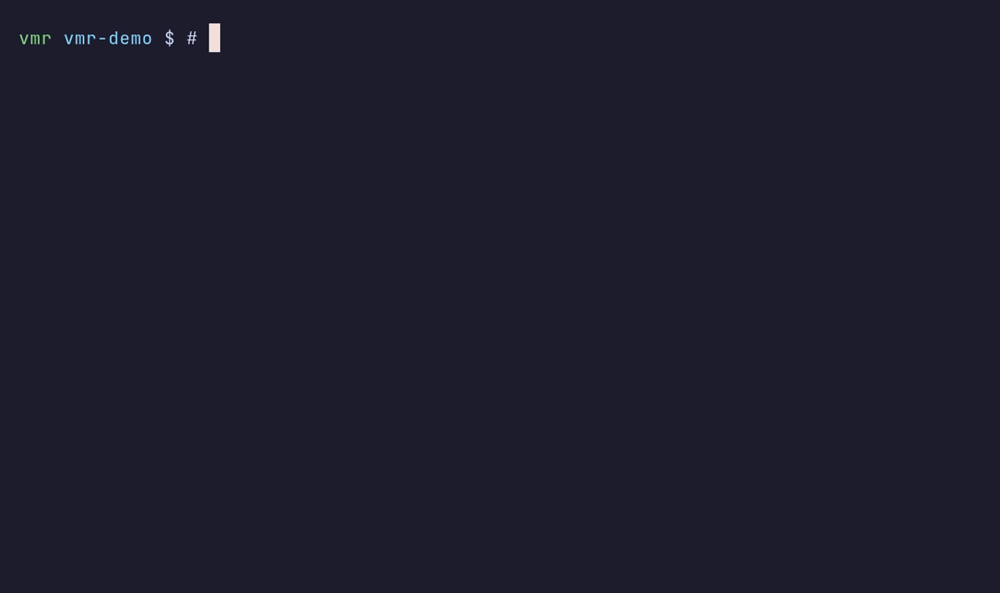

<p align="center">
  
</p>

# vmr · Cross-platform SDK version manager

English | [简体中文](README_CN.md)

Documentation: [English](https://gvcgo.github.io/version-manager/) · [简体中文](https://gvcgo.github.io/version-manager/zh/)

`vmr` lets you keep multiple versions of your development tools on one machine and switch to the one you need at any time: Go, Node.js, Python, JDK, Rust, Lua… Install, switch and uninstall with a single command — no admin privileges, no pollution of system directories.

- **Multiple versions coexist**: many versions of the same SDK live side by side; switching just repoints a symlink.
- **Project-level pinning**: entering a project directory automatically switches to the version the project needs, and leaving restores the previous one.
- **Session isolation**: run a command or open a subshell with a temporary version; everything is restored when it exits.
- **Migrate to a new machine in one command**: export the list of installed versions and install them all in bulk on the new machine.
- **Install any conda-forge package**: pixi's installation capability is built in — no preinstalled conda/miniconda required.
- **Multi-threaded downloads**: checksum verification, reverse proxy, local proxy and `HTTP(S)_PROXY` support.

Linux / macOS / Windows are supported, with prebuilt packages for both x86_64 and aarch64.

## Demo



The recording is generated from [`vmr/docs/demo.tape`](vmr/docs/demo.tape) with [VHS](https://github.com/charmbracelet/vhs).

## Installation

### 1. Homebrew (macOS / Linux)

```bash
brew install gvcgo/tap/vmr
```

The formula ships the prebuilt binary for your platform, so nothing is compiled locally. Homebrew only provides the `vmr` executable — SDK versions are still installed by vmr itself under `~/.vmr`.

### 2. MacPorts (macOS)

MacPorts has no Homebrew-style tap mechanism, so vmr publishes a small port source. Add it once and install:

```bash
sudo mkdir -p /opt/local/var/macports/sources/github.com/gvcgo
sudo git clone https://github.com/gvcgo/vmr-macports \
  /opt/local/var/macports/sources/github.com/gvcgo/vmr-macports
echo "file:///opt/local/var/macports/sources/github.com/gvcgo/vmr-macports [nosync]" \
  | sudo tee -a /opt/local/etc/macports/sources.conf
sudo portindex /opt/local/var/macports/sources/github.com/gvcgo/vmr-macports
sudo port install vmr
```

The port installs the same prebuilt binary as Homebrew and the release archives, so nothing is compiled locally. Replace `/opt/local` with your MacPorts prefix if it differs. To update later, pull the source, regenerate the index, and upgrade:

```bash
sudo git -C /opt/local/var/macports/sources/github.com/gvcgo/vmr-macports pull
sudo portindex /opt/local/var/macports/sources/github.com/gvcgo/vmr-macports
sudo port upgrade vmr
```

See [vmr-macports](https://github.com/gvcgo/vmr-macports) for details.

### 3. Scoop (Windows)

```powershell
scoop bucket add gvcgo https://github.com/gvcgo/scoop-bucket
scoop install gvcgo/vmr
```

### 4. APT (Debian / Ubuntu)

```bash
curl -fsSL https://gvcgo.github.io/vmr-apt/vmr.gpg \
  | sudo gpg --dearmor -o /usr/share/keyrings/vmr.gpg
echo "deb [signed-by=/usr/share/keyrings/vmr.gpg] https://gvcgo.github.io/vmr-apt stable main" \
  | sudo tee /etc/apt/sources.list.d/vmr.list
sudo apt update
sudo apt install vmr
```

### 5. pacman (Arch Linux)

```bash
curl -fsSLO https://gvcgo.github.io/vmr-pacman/vmr.gpg
sudo pacman-key --add vmr.gpg
sudo pacman-key --lsign-key C387E9AE5C936248D446868C44E5A0323545E858
```

Append the repository to `/etc/pacman.conf`:

```ini
[vmr]
SigLevel = Required DatabaseOptional
Server = https://gvcgo.github.io/vmr-pacman/$arch
```

Then install:

```bash
sudo pacman -Syu vmr
```

### 6. Cargo (from source)

Requires Rust 1.93+ and a C toolchain (Xcode Command Line Tools on macOS, MSVC Build Tools on Windows, `build-essential` and `pkg-config` on Linux). The workspace lives under `vmr/`, so clone the repository and install the `vmr-cli` package:

```bash
git clone https://github.com/gvcgo/version-manager
cd version-manager
cargo install --path vmr/crates/vmr-cli --locked
```

`vmr` is installed to `~/.cargo/bin`; make sure that directory is on `PATH`. To upgrade after pulling changes, rerun the last command with `--force`:

```bash
cargo install --path vmr/crates/vmr-cli --locked --force
```

The crates are not published to crates.io, so `cargo install vmr` is not available.

### 7. Download

Get the package for your platform from [Releases](https://github.com/gvcgo/version-manager/releases):

| Platform | Example package name |
|---|---|
| macOS (Apple silicon) | `vmr-aarch64-apple-darwin.tar.xz` |
| macOS (Intel) | `vmr-x86_64-apple-darwin.tar.xz` |
| Linux (x86_64) | `vmr-x86_64-unknown-linux-gnu.tar.xz` |
| Linux (ARM64) | `vmr-aarch64-unknown-linux-gnu.tar.xz` |
| Windows (x64) | `vmr-x86_64-pc-windows-msvc.zip` |
| Windows (ARM64) | `vmr-aarch64-pc-windows-msvc.zip` |

### 8. Extract and put it on PATH

Linux / macOS:

```bash
tar -xJf vmr-x86_64-apple-darwin.tar.xz
mkdir -p ~/.local/bin
install -m 755 vmr-x86_64-apple-darwin/vmr ~/.local/bin/vmr
# make sure ~/.local/bin is on PATH
```

Windows: after extracting, put `vmr.exe` in any directory already on `PATH`.

### 9. Verify (optional)

Every package ships with a `.sha256` file, and the release page also has an aggregated `SHA256SUMS`:

```bash
shasum -a 256 -c vmr-x86_64-apple-darwin.tar.xz.sha256
```

### 10. Confirm the install

```bash
vmr version
```

## Documentation

See the [documentation](https://gvcgo.github.io/version-manager/) for the [quick start](https://gvcgo.github.io/version-manager/starts/quickstart), [usage guide](https://gvcgo.github.io/version-manager/guides/tutorial), [command reference](https://gvcgo.github.io/version-manager/reference/commands), and [plugin API](https://gvcgo.github.io/version-manager/plugins/).

## Feedback

- Questions and suggestions: [Issues](https://github.com/gvcgo/version-manager/issues)
- Downloads: [Releases](https://github.com/gvcgo/version-manager/releases)
- Implementation and development notes: [vmr/readme.md](vmr/readme.md)

## Star History

[](https://star-history.com/#gvcgo/version-manager&Date)
