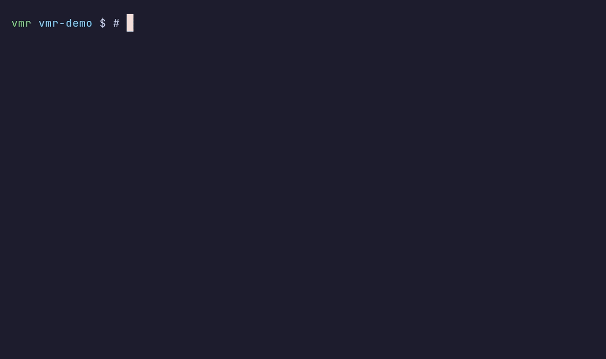

<p align="center">
  
</p>

# vmr · Cross-platform SDK version manager

English | [简体中文](README_CN.md)

`vmr` lets you keep multiple versions of your development tools on one machine and switch to the one you need at any time: Go, Node.js, Python, JDK, Rust, Lua… Install, switch and uninstall with a single command — no admin privileges, no pollution of system directories.

- **Multiple versions coexist**: many versions of the same SDK live side by side; switching just repoints a symlink.
- **Project-level pinning**: entering a project directory automatically switches to the version the project needs, and leaving restores the previous one.
- **Session isolation**: run a command or open a subshell with a temporary version; everything is restored when it exits.
- **Migrate to a new machine in one command**: export the list of installed versions and install them all in bulk on the new machine.
- **Install any conda-forge package**: pixi's installation capability is built in — no preinstalled conda/miniconda required.
- **Multi-threaded downloads**: checksum verification, reverse proxy, local proxy and `HTTP(S)_PROXY` support.

Linux / macOS / Windows are supported, with prebuilt packages for both x86_64 and aarch64.

## Demo



The recording is generated from [`vmr/docs/demo.tape`](vmr/docs/demo.tape) with [VHS](https://github.com/charmbracelet/vhs).

## Installation

### 1. Homebrew (macOS / Linux)

```bash
brew install gvcgo/tap/vmr
```

The formula ships the prebuilt binary for your platform, so nothing is compiled locally. Homebrew only provides the `vmr` executable — SDK versions are still installed by vmr itself under `~/.vmr`.

### 2. MacPorts (macOS)

MacPorts has no Homebrew-style tap mechanism, so vmr publishes a small port source. Add it once and install:

```bash
sudo mkdir -p /opt/local/var/macports/sources/github.com/gvcgo
sudo git clone https://github.com/gvcgo/vmr-macports \
  /opt/local/var/macports/sources/github.com/gvcgo/vmr-macports
echo "file:///opt/local/var/macports/sources/github.com/gvcgo/vmr-macports [nosync]" \
  | sudo tee -a /opt/local/etc/macports/sources.conf
sudo portindex /opt/local/var/macports/sources/github.com/gvcgo/vmr-macports
sudo port install vmr
```

The port installs the same prebuilt binary as Homebrew and the release archives, so nothing is compiled locally. Replace `/opt/local` with your MacPorts prefix if it differs. To update later, pull the source, regenerate the index, and upgrade:

```bash
sudo git -C /opt/local/var/macports/sources/github.com/gvcgo/vmr-macports pull
sudo portindex /opt/local/var/macports/sources/github.com/gvcgo/vmr-macports
sudo port upgrade vmr
```

See [vmr-macports](https://github.com/gvcgo/vmr-macports) for details.

### 3. Scoop (Windows)

```powershell
scoop bucket add gvcgo https://github.com/gvcgo/scoop-bucket
scoop install gvcgo/vmr
```

### 4. APT (Debian / Ubuntu)

```bash
curl -fsSL https://gvcgo.github.io/vmr-apt/vmr.gpg \
  | sudo gpg --dearmor -o /usr/share/keyrings/vmr.gpg
echo "deb [signed-by=/usr/share/keyrings/vmr.gpg] https://gvcgo.github.io/vmr-apt stable main" \
  | sudo tee /etc/apt/sources.list.d/vmr.list
sudo apt update
sudo apt install vmr
```

### 5. pacman (Arch Linux)

```bash
curl -fsSLO https://gvcgo.github.io/vmr-pacman/vmr.gpg
sudo pacman-key --add vmr.gpg
sudo pacman-key --lsign-key C387E9AE5C936248D446868C44E5A0323545E858
```

Append the repository to `/etc/pacman.conf`:

```ini
[vmr]
SigLevel = Required DatabaseOptional
Server = https://gvcgo.github.io/vmr-pacman/$arch
```

Then install:

```bash
sudo pacman -Syu vmr
```

### 6. Cargo (from source)

Requires Rust 1.88+ and a C toolchain (Xcode Command Line Tools on macOS, MSVC Build Tools on Windows, `build-essential` and `pkg-config` on Linux). The workspace lives under `vmr/`, so clone the repository and install the `vmr-cli` package:

```bash
git clone https://github.com/gvcgo/version-manager
cd version-manager
cargo install --path vmr/crates/vmr-cli --locked
```

`vmr` is installed to `~/.cargo/bin`; make sure that directory is on `PATH`. To upgrade after pulling changes, rerun the last command with `--force`:

```bash
cargo install --path vmr/crates/vmr-cli --locked --force
```

The crates are not published to crates.io, so `cargo install vmr` is not available.

### 7. Download

Get the package for your platform from [Releases](https://github.com/gvcgo/version-manager/releases):

| Platform | Example package name |
|---|---|
| macOS (Apple silicon) | `vmr-aarch64-apple-darwin.tar.xz` |
| macOS (Intel) | `vmr-x86_64-apple-darwin.tar.xz` |
| Linux (x86_64) | `vmr-x86_64-unknown-linux-gnu.tar.xz` |
| Linux (ARM64) | `vmr-aarch64-unknown-linux-gnu.tar.xz` |
| Windows (x64) | `vmr-x86_64-pc-windows-msvc.zip` |
| Windows (ARM64) | `vmr-aarch64-pc-windows-msvc.zip` |

### 8. Extract and put it on PATH

Linux / macOS:

```bash
tar -xJf vmr-x86_64-apple-darwin.tar.xz
mkdir -p ~/.local/bin
install -m 755 vmr-x86_64-apple-darwin/vmr ~/.local/bin/vmr
# make sure ~/.local/bin is on PATH
```

Windows: after extracting, put `vmr.exe` in any directory already on `PATH`.

### 9. Verify (optional)

Every package ships with a `.sha256` file, and the release page also has an aggregated `SHA256SUMS`:

```bash
shasum -a 256 -c vmr-x86_64-apple-darwin.tar.xz.sha256
```

### 10. Confirm the install

```bash
vmr version
```

## Shell integration

Once installed, add the following line to your shell config (`~/.zshrc`, `~/.bashrc`, `~/.config/fish/config.fish`):

```bash
# zsh
eval "$(vmr init zsh)"
```

```bash
# bash
eval "$(vmr init bash)"
```

```fish
# fish
vmr init fish | source
```

```powershell
# Windows PowerShell: add to $PROFILE
Invoke-Expression (& vmr init powershell)
```

This single line does three things:

1. injects the environment variables maintained by vmr (`PATH`, `GOROOT`, etc.) into the current shell;
2. registers a `cd` hook that switches automatically when you enter a project directory with a version lock;
3. defines the `vmr` wrapper function — after `vmr use` / `vmr uninstall`, the change takes effect **immediately in the current window**, with no need to open a new terminal.

The commands work without `vmr init` too, but each version switch then requires a new terminal.

On Windows, global environment variables other than `PATH` (e.g. `GOROOT`) go to the registry
(`HKCU\Environment`), while `PATH` holds **one** entry: `%USERPROFILE%\.vmr\bin`. `vmr use`
creates a shim for every executable of the active SDK (a hardlink to `vmr.exe`, or a generated
`.cmd` wrapper for script targets); the shim injects that prefix's `PATH` for the child process
only. Any number of SDKs or conda-forge packages therefore cannot push `PATH` towards the
32,767-character Windows limit.

### Upgrading from 0.7.x to 0.8.x

- Remove non-SDK environment variables and functions written by the old version of vmr from `$HOME/.vmr/vmr.sh` or the PowerShell `$PROFILE`; keep SDK-related configuration.
- Remove old vmr-related code from shell configuration files such as `~/.zshrc` and `~/.bashrc`, and add the appropriate `vmr init` command shown above instead. PowerShell users should also use the initialization command above in `$PROFILE`.
- Reopen the terminal to apply the new shell configuration.

## Quick start

```bash
vmr plugins              # see which SDKs are supported
vmr search go            # list Go versions installable on this platform
vmr use go@1.22.0        # install and switch
vmr local go             # list installed versions; <current> marks the active one
vmr uninstall go@1.22.0  # uninstall a specific version
vmr uninstall go@all     # uninstall all versions of this SDK
```

`vmr search` results come from live plugin lookups, so the first query goes online; add `-n` to ignore the local cache and refetch.

Writing a plugin: see the [Lua plugin API reference](vmr/docs/plugin-api.md) (简体中文: [plugin-api.zh-CN.md](vmr/docs/plugin-api.zh-CN.md)).

## Common commands

| Command | Alias | Description |
|---|---|---|
| `vmr version` | `v` | Show the version |
| `vmr init [shell]` | | Print the shell integration script |
| `vmr plugins [-u]` | | List supported SDKs; `-u` updates the plugin bundle first |
| `vmr search <sdk>` | `s` | List installable versions; `-p` uses the conda-forge channel, `-n` ignores the cache |
| `vmr use <sdk>@<version>` | `u` / `h` | Install and switch (global by default) |
| `vmr use -s ...` | | Apply to the current session only |
| `vmr use -l ...` | | Write the project `.vmr.lock` and enter a new session |
| `vmr use -p ...` | | Install any conda-forge package |
| `vmr use -f <file>` | | Bulk install from a manifest |
| `vmr local [sdk]` | `l` | List installed versions; `-c` shows only the current version |
| `vmr freeze [file]` | `fz` | Export the list of installed versions |
| `vmr uninstall <sdk>@<version>` | `uni` / `r` | Uninstall; `@all` removes every version |
| `vmr cdhook` | `cd-hook` | Called internally by the cd hook: read `.vmr.lock`, offer to install missing pinned versions, and inject the environment (the hook caches the project in `VMR_CD_CACHE` and skips repeated lookups) |
| `vmr session` | `se` | Query whether the current shell is inside a vmr session |
| `vmr nested` | `ns` | Allow / disallow nested sessions |
| `vmr doctor` | | Read-only diagnosis of shell integration, environment variables, `PATH` and version links (`--json`, `--quiet`, `--strict`) |
| `vmr mcp` | | Serve MCP over stdio for AI clients |

## Project-level version pinning

To pin a repository to specific versions, run this once in the project root:

```bash
cd my-project
vmr use -l node@20.11.0
```

This will:

- write `.vmr.lock` in the project root (recording the SDKs and versions this project needs);
- because shell integration is active, `cdhook` switches to the pinned version every time you `cd` into this directory afterwards;
- the `.vmr.lock` lookup runs once per project: the hook caches the resolved project in `VMR_CD_CACHE`, so moving around inside the project does not repeat it (switching to another directory does);
- if a pinned version is not installed yet, `cdhook` lists it and asks before installing it (declining skips the install);
- restore the previous version via the shell hook when you leave the directory.

Committing `.vmr.lock` to the repository is recommended — team members get the pinned versions simply by `cd`ing in.

## Session mode

Run commands with a temporary version without touching global settings:

```bash
vmr use -s python@3.12.2
# everything is restored when this subshell exits
```

Ideal for "I just want to try the new version in this terminal". To open another session layer inside a session, allow it first with `vmr nested`.

## Backup and migration

```bash
vmr freeze                    # export; writes vmr_20260101.txt by default
vmr use -f vmr_20260101.txt   # bulk install on the new machine
```

The manifest is plain text, one `sdk@version` per line, with `#` starting a comment. Each SDK's current version is written last, so after a bulk install the active versions match those at export time.

## Installing any conda-forge package

vmr has pixi's installation capability built in, so besides the SDKs in the plugin bundle you can also install packages directly from conda-forge:

```bash
vmr search -p lua        # query conda-forge
vmr use -p lua@5.4.6     # install
```

Like plugin installs, `vmr use -p` exposes the prefix's executables (`bin` is added to `PATH`
on Linux/macOS; on Windows a shim is generated per executable instead of appending registry
`PATH` entries), so `lua` is available immediately with the `vmr init` shell integration.
Variables set by a package's `etc/conda/activate.d` scripts are not imported.

The default channel is `https://conda.anaconda.org/conda-forge`; use the environment variable to point at a mirror:

```bash
export VMR_PIXI_CHANNEL=https://mirrors.tuna.tsinghua.edu.cn/anaconda/cloud/conda-forge
vmr search -p lua
```

## Configuration

The config file lives at `~/.vmr/conf.toml`. If that file does not exist, vmr reads
`~/.config/vmr/conf.toml` instead; `vmr` never merges the two, and writes go back to whichever
file it read (when neither exists, `~/.vmr/conf.toml` is created). Keys are PascalCase:

| Key | Description |
|---|---|
| `ProxyUri` | Local proxy, e.g. `http://127.0.0.1:7890` |
| `ReverseProxy` | Reverse proxy prefix |
| `SDKIntallationDir` | Version installation directory (yes, the key is spelled that way) |
| `VersionHostUrl` | Version metadata service URL |
| `ThreadNum` | Number of download threads |
| `AllowNestedSessions` | Whether nested sessions are allowed |
| `GithubToken` | GitHub API token |
| `CacheRetentionTime` | Cache retention in seconds |
| `DisableCache` | Disable caching |

Common environment variables (these take precedence over the config file):

| Variable | Description |
|---|---|
| `VMR_SDK_INSTALLATION_DIR` | Root directory for versions and cache |
| `VMR_HOST` | Version metadata service URL |
| `VMR_LOCAL_PROXY` | Local proxy |
| `VMR_REVERSE_PROXY` | Reverse proxy prefix |
| `VMR_DOWNLOAD_THREADS` | Number of download threads |
| `VMR_ALLOW_NESTED_SESSIONS` | Allow nested sessions |
| `VMR_PIXI_CHANNEL` | conda-forge channel (mirrors supported) |
| `VMR_GITHUB_TOKEN` | GitHub token; falls back to `GITHUB_TOKEN` when unset |
| `HTTP_PROXY` / `HTTPS_PROXY` / `NO_PROXY` | Standard proxy variables, honored as-is |

When all three GitHub token sources are empty, the GitHub API is queried anonymously at 60 requests per hour — enough to refresh version lists for only a few SDKs; if you install many, configure a token.

## Where the data lives

```
~/.vmr/
├── conf.toml            # configuration
├── vmr.sh / vmr.fish    # dynamic environment variables (PATH, GOROOT, etc.)
├── env_keys.txt         # non-PATH variables to clear before refreshing
├── bin/                 # Windows shim directory (the only PATH entry)
├── shims.json           # Windows shim → real executable mapping
├── plugins/             # SDK version plugins (downloaded automatically on first use)
├── cache/               # version lists and installer package cache
└── versions/
    └── <sdk>_versions/
        ├── <sdk>-<version>/   # actual installation directory
        └── <sdk>              # points to the current version
```

To put this on another disk, just set `VMR_SDK_INSTALLATION_DIR`.

On Windows, global environment variables are written to the registry under `HKCU\Environment`
and changes are broadcast; `PATH` keeps a single entry, `%USERPROFILE%\.vmr\bin`, whose shims
provide the SDK commands, so no system settings need editing beyond `vmr init powershell`.

## Uninstalling vmr

```bash
vmr uninstall <sdk>@all   # first remove SDK versions you no longer need
rm -rf ~/.vmr             # then delete config, cache and remaining versions
# finally remove the eval "$(vmr init ...)" line from your shell config
```

On Windows, delete the `%USERPROFILE%\.vmr` directory and remove both the directory containing
`vmr.exe` and `%USERPROFILE%\.vmr\bin` (the shim directory) from `PATH`.

## FAQ

**`vmr: command not found`**
The executable is not on `PATH`. Verify that `which vmr` (or `where vmr` on Windows) finds it.

**I switched versions but the current terminal still uses the old one**
Either `vmr init` was not run, or `command vmr` was used, bypassing the wrapper function. Add the shell integration and reopen the terminal.

**`vmr search` reports rate limiting**
Anonymous GitHub requests are capped at 60 per hour. Configure `GithubToken` or the `VMR_GITHUB_TOKEN` environment variable.

**Downloads are slow / cannot connect**
Set `HTTP_PROXY` / `HTTPS_PROXY` first; use `VMR_LOCAL_PROXY` to proxy vmr only; use `VMR_PIXI_CHANNEL` to route conda-forge through a mirror.

**I want to refetch the version list**
Use `vmr search <sdk> -n`, or delete `~/.vmr/cache/` and retry.

**`vmr use` fails inside a session**
Nested sessions are disallowed by default: allow them with `vmr nested`, or exit the current session.

**Upgrading vmr itself**
Download the new package and overwrite the old binary; the versions and config under `~/.vmr` are unaffected.

## Feedback

- Questions and suggestions: [Issues](https://github.com/gvcgo/version-manager/issues)
- Downloads: [Releases](https://github.com/gvcgo/version-manager/releases)
- Implementation and development notes: [vmr/readme.md](vmr/readme.md)

## Star History

[](https://star-history.com/#gvcgo/version-manager&Date)
